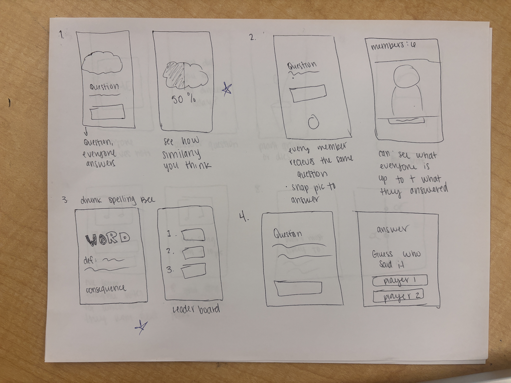
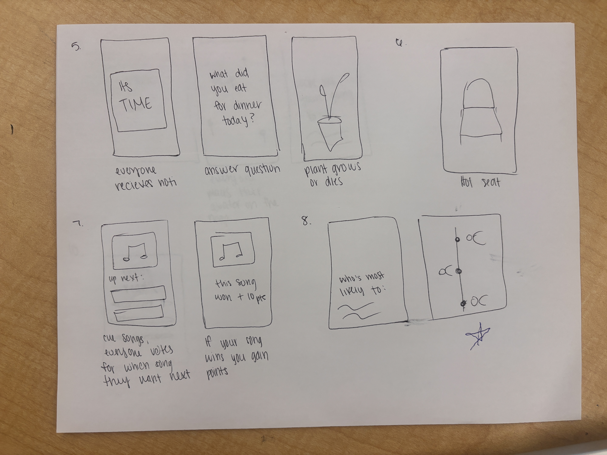
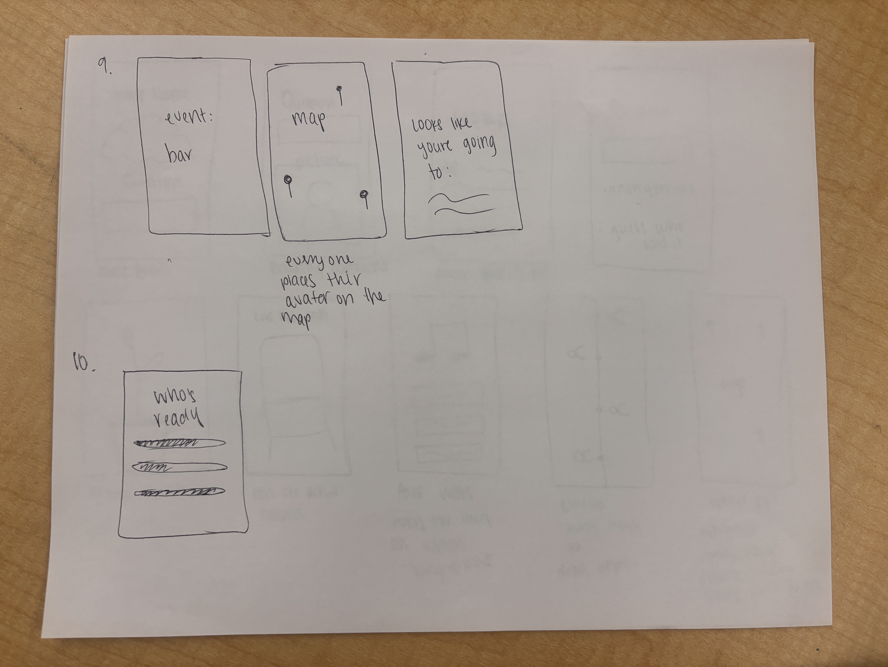
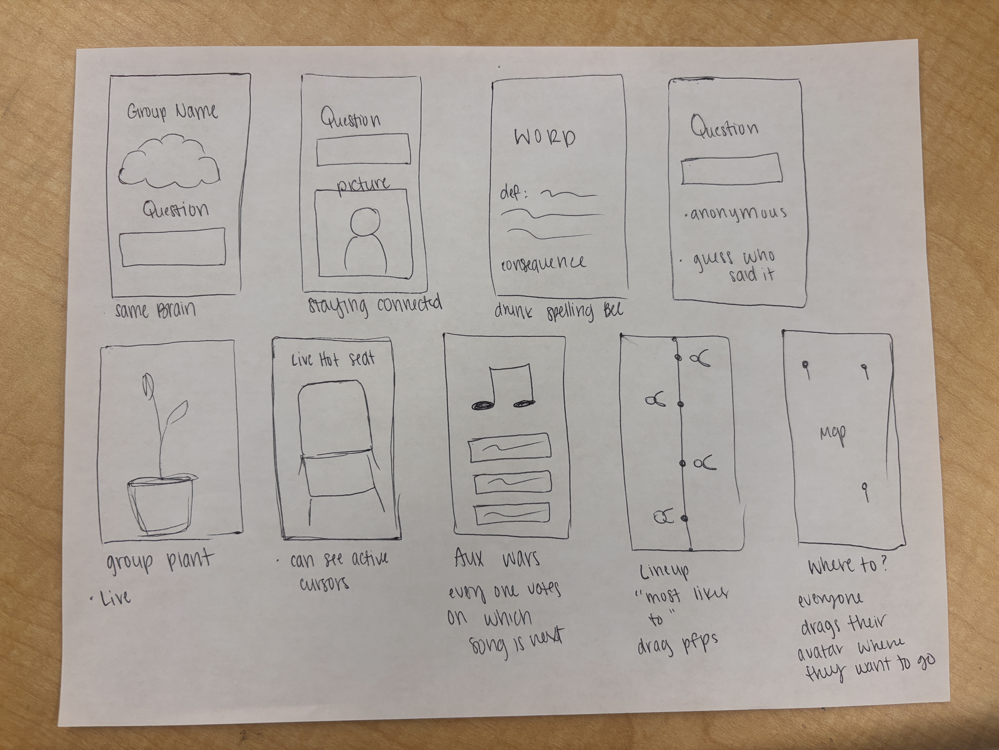
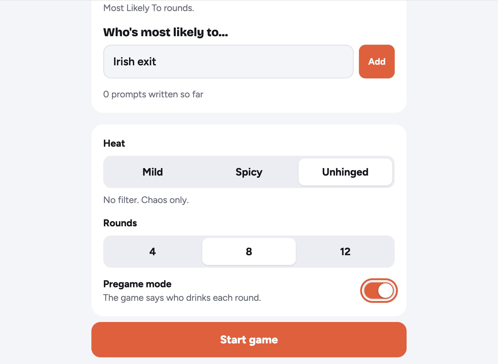
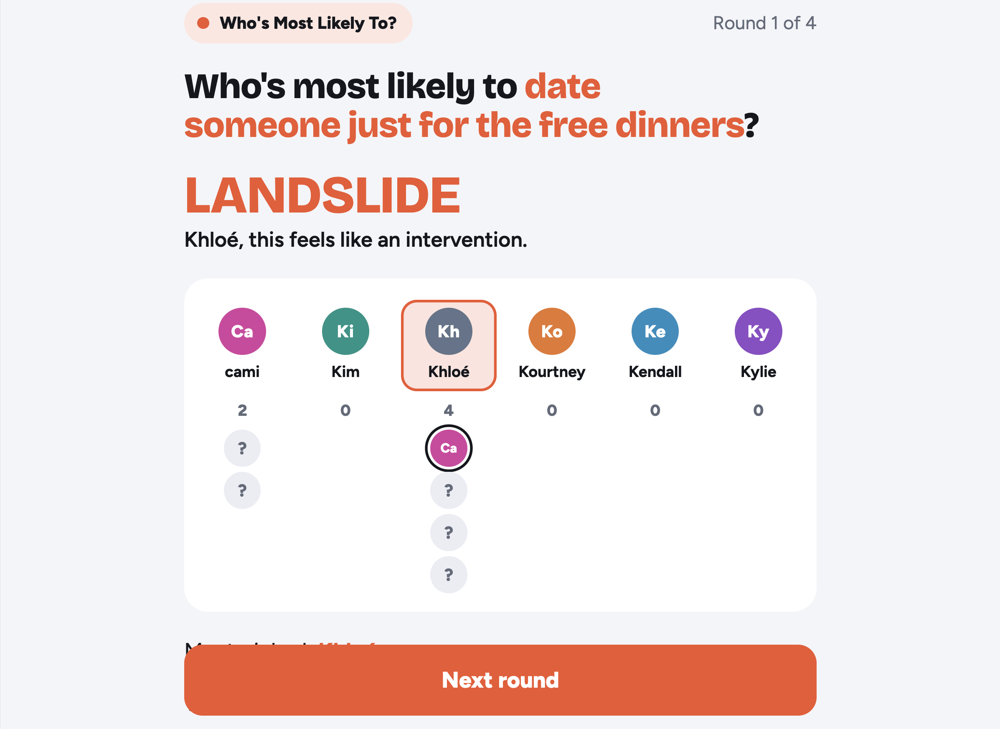
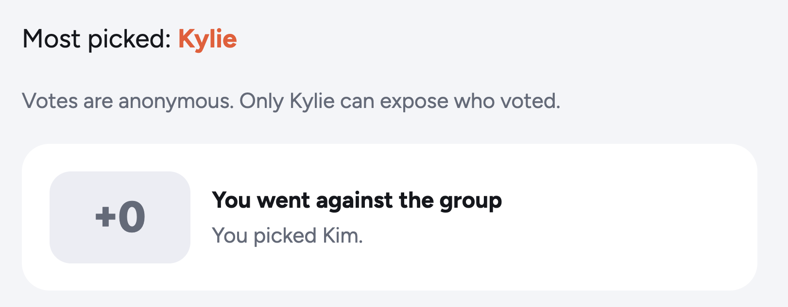
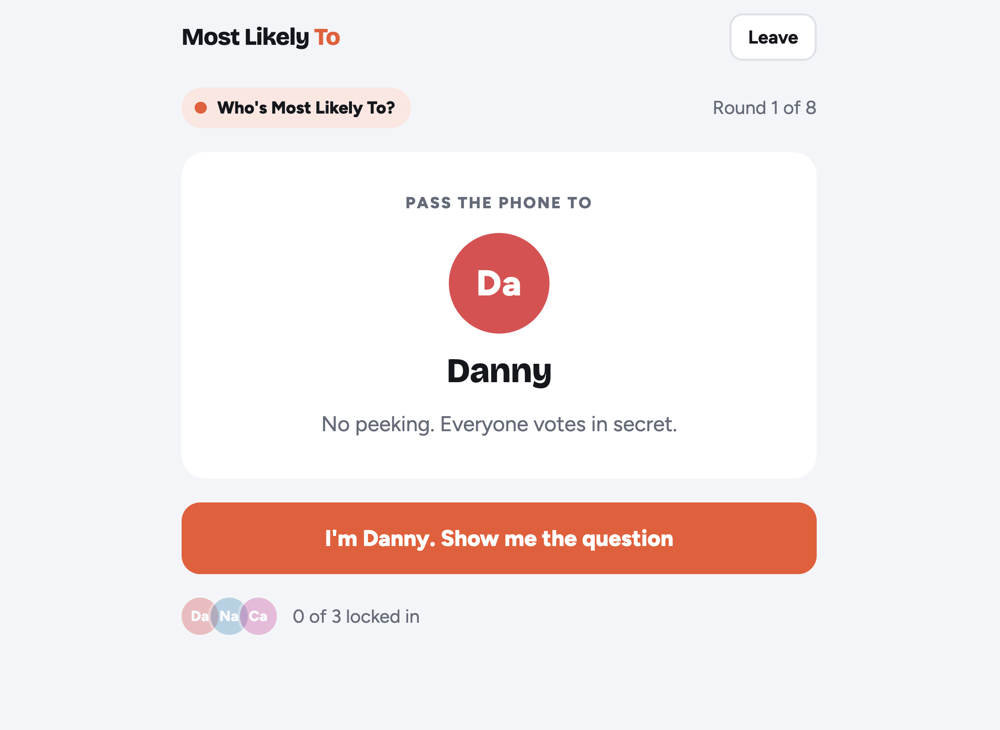

# Interview takeaways

- **Date:** 11/3
- **Interviewer:** Cami
- **Interviews:** 3

## Interview 1: Working parent, works from home

**Their days:** Up around 6. Coffee in the sunroom with SportsCenter, walks the dogs, works from home until 4:30. Evenings vary.

**Group life:** Sees friends about once a week. They go to wineries, speakeasies and bars to watch games. Most recently they dressed up for Halloween, went shopping and went to a winery.

**How plans get made:** Events they find on Facebook and TikTok. "Whatever pops up that looks interesting."

**Games:** Cards Against Humanity, Spades, and whatever board games people already have at home. They bought a CAH expansion because they'd seen all the cards. They take game recommendations from coworkers. Ideas they offered: a fast, competitive game called "Piles" (name as heard), Mahjong tournaments (in person, plus apps), Phase 10 ("kind of boring") and Trivia Crack.

**What gets in the way:** Kids' schedules and kid events, so plans get rescheduled a lot.

**Key points:**

- A good game means laughing, a fast pace, competition and trash talk.
- They lose interest when the vibe is "solemn and low key." Their fix: "Play more games."
- They wish the group did more dinners at each other's houses and more game nights.
- Games wear out once you know all the content, so they want fresh content.
- Small talk and group settings (holiday parties, shared activities) make it easier to connect with new people.

## Interview 2: Works, goes to the gym, does homework

**Their days:** Work, gym, dinner, homework, TV. Weekends are one reset day (laundry, homework) and one social day (coffee, shops, friends).

**Group life:** Sees friends a few times a week. They thrift, get coffee, go out to dinner in KC or Lawrence, and go out. They also watch the same TV shows and then talk them over together. Most recently they went out for Halloween and caught up with a friend they don't see often.

**How plans get made:** They ask in the group chat and "see what the vibes are."

**Games:** Cards Against Humanity with friends. With family: Swoop, a knockoff of poker, and Shit on Your Neighbor.

**What gets in the way:** Busy schedules (work, school). They also have a strong sense of their own vibe, which makes it hard to stay open to new people.

**Key points:**

- **Big Wordle fan.** They love leaderboards, streaks and seeing how many tries it took, and they like seeing *how other people got it*.
- Likes Kahoot when the topic interests them.
- A group game is fun when it has a mix of personalities. They'd play again if nobody got bored and everyone was into it.
- They lose interest when the vibes feel weird or they aren't comfortable. "I'd rather have small talk than silence."
- Group settings take the stress off meeting new people, more than one-on-one does.
- **Wish:** a "preview" of what someone is like before hanging out, beyond their Instagram.
- Wants to try hot yoga with friends.

## Interview 3: College student, very social, sports-focused

**Their days:** Practice from 8 to 10, then class, then work or tennis and the gym, then the rest of the night with friends. On weekends: brunch, a sport on Saturday, then going out.

**Group life:** Hangs out about 3 days a week (and lives with roommates). The routine: meet at their house, talk it over, then get food and/or hit the bar (Mass Street, the Triangle). It's a set weekend ritual, coordinated across several group chats. Most recently the friends dressed up as superheroes for Halloween.

**Games:** Sports (basketball, baseball). Video games: NBA 2K, MLB The Show, and their roommates play Overwatch and Rocket League. **Daily puzzles:** Wordle, Connections, Map Tap, GeoGuessr, "Origin Guesser," and a favorite that sounded like "Crillion/Acryian" (name unclear).

**What gets in the way:** Not being around people, or having different interests. They also admit to a short attention span.

**Key points:**

- **They mostly play daily games alone at work, then text friends their scores** ("I got it in three"). One game they play together in person.
- The favorite is collaborative: "when we all work together we can come up with the niche answer."
- Competition gets "hostile, but not for very long," and it's friendly banter.
- They come back for "the thrill," the competitive adrenaline.
- They connect with people through shared hometowns, mutual friends, music, sports and drinking.
- They wish the group did more spontaneous things: KC trips, golf, the lake.
- **Idea:** something like BeReal (show what you're doing right now) with a game layer, Pokémon Go style ("catch" people).

## Patterns across all three

1. **Cards Against Humanity came up in all three.** Funny, low-effort party games are a shared baseline, but the content goes stale.
2. **Halloween was the "last fun group thing" for everyone.** Dress-up and themed events stick.
3. **Schedules are the main barrier:** kids, work and school.
4. **The vibe decides whether people stay.** Silence, awkwardness or a low-energy night drives people off. Games are how they fix a flat night.
5. **Daily games plus sharing scores is an existing habit** (Wordle, Connections). Two of the three already do it: they want streaks, leaderboards and a look at how others played. This fits the brief's advice to "ride on existing behavior."
6. **Both competition and collaboration work.** Trash talk and leaderboards, but also "we figured it out together."
7. **Groups make meeting people easier than one-on-one,** and small talk beats silence.
8. **Plans start in group chats or social feeds**, not in a dedicated app.

## Possible directions

- A daily shared game with a group leaderboard that also works as an in-person party mode.
- A way to keep party-game content fresh.
- A cue that sparks spontaneous hangouts around the group chat people already use.

# Sketches and concepts

- **Date:** 11/4

# First concept and user testing

The direction I chose was to combine the concepts "same brain" and "who's most likely". I had Claude create me a very ugly prototype just to test the concept.

For testing purposes, you can choose to play against bots (which are the Kardashians/Jenners), or you can choose to play with real people and pass the phone/laptop.

You can include your own questions to add to the rotation. You choose how extreme you want the questions to be, the amount of rounds you play, and whether or not you want to make it a drinking game.

You are able to answer questions as a group. There are multiple kinds of questions to be answered such as "who's most likely to" and "same brain".

If the person most guessed has enough points, they can choose to reveal who selected them for the question.

This is a visual for how the real life one works. Each round you have to pass the phone to whoever's turn it is.

## User feedback

- Overall, the feedback that I received is that there is just too much going on. Players were confused about what the overall purpose was.
- The players understood the questions, but they didn't necessarily understand that they were competing against each other.
- I think the point also got a little blurry. Some questions were asking something specific that got overlooked just a little bit.
- Players also didn't realize they were on a timer, so there was no urgency.
- I think overall, the lack of urgency and the unclear purpose made users a bit confused or disengaged.
- I think if we go in this direction, we will have to figure out a way to make the concept more clear, the UI less busy, and overall appeal more enticing.

# Multiplayer proof of concept

- **Date:** 11/11
- **Live link:** https://group3-test-room.cami-ixd.workers.dev
- Details and code: [multiplayer-poc](multiplayer-poc/)
