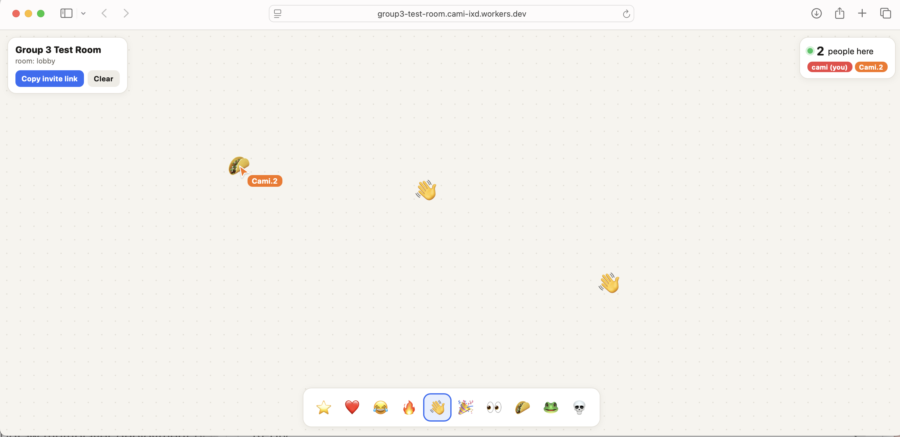

# Multiplayer Board: PartyServer proof of concept

**Live multiplayer link: https://group3-test-room.cami-ixd.workers.dev**

Open it, type a name, and send the link to others. Everyone on the same link sees each other's cursors and can drop emoji stickers on the same board at once.

- **Stack:** PartyServer (PartyKit's successor) on Cloudflare Workers, with plain HTML for the page
- **Deployed from:** this folder, with `npm run deploy`

## Run locally
    cd app
    npm install
    npm run dev

## Notes
- No license key needed. I picked this over tldraw sync because tldraw needs a key on a real website, and it wouldn't have arrived before class.
- Add `?room=anything` to the link for a separate board.
- Boards live in memory, so they reset when everyone leaves.
