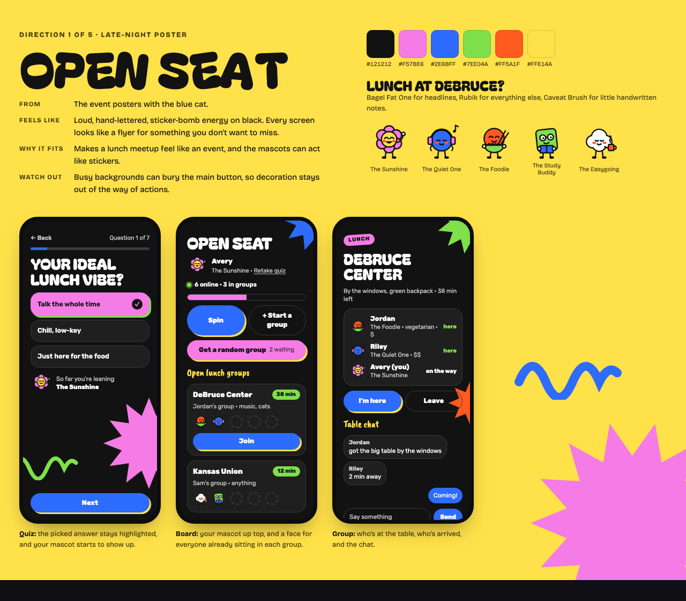
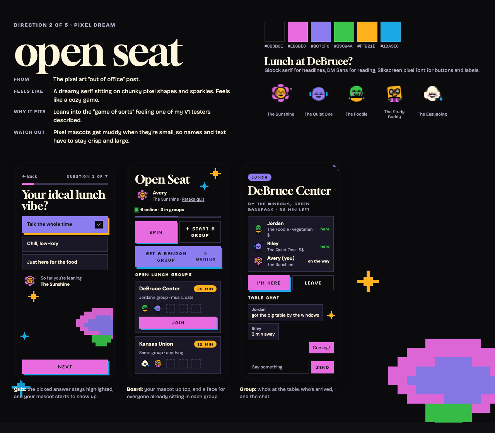
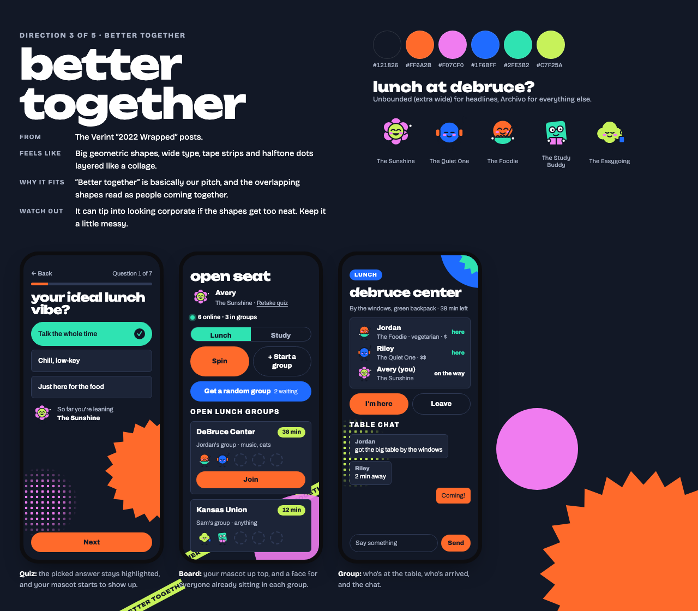
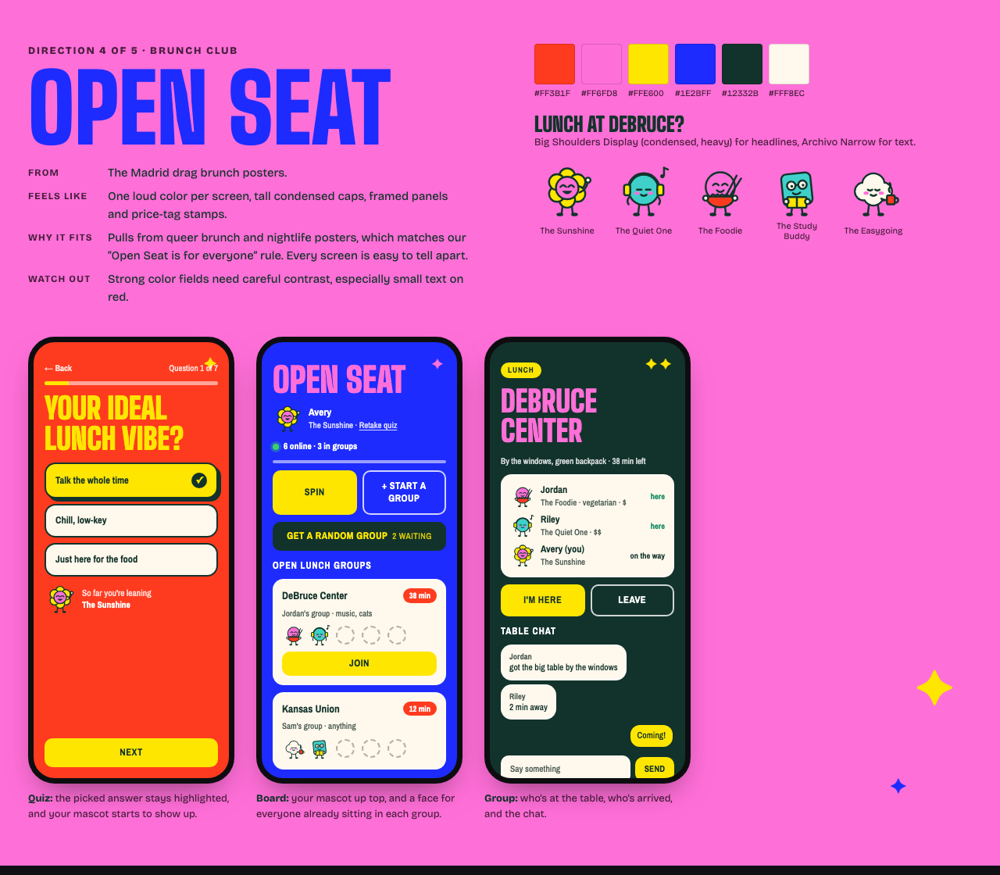
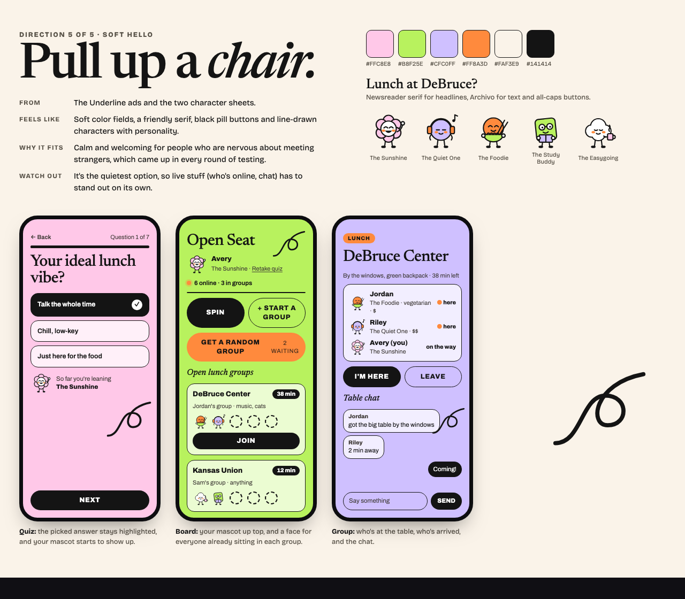

# Open Seat: 5 visual iterations

Five visual directions for Open Seat, pulled from my mood board. This is a proof of concept for picking a look as a group. Nothing here is hooked up to the live app yet.

Each direction shows the same three screens:

- **Quiz:** the picked answer stays highlighted, since V3 testing showed nobody could tell what they'd tapped ([testing notes](../2026-11-16_Open_Seat_V3_Testing.md)).
- **Board:** your mascot up top, and a face for everyone already sitting in each group.
- **Group:** who's at the table, who's arrived, and the chat.

The archetype mascots (Sunshine, Quiet One, Foodie, Study Buddy, Easygoing) are rough placeholders to show how characters could work in each style. They're not our final branding.

**See it:** open [index.html](index.html) in a browser (download the folder, or run `python3 -m http.server` in it). The screenshots below show the same thing.

## 1. Late-Night Poster

From the event posters with the blue cat. Loud, hand-lettered, sticker-bomb energy on black. Makes a lunch meetup feel like an event.

## 2. Pixel Dream

From the pixel art "out of office" post. A dreamy serif on chunky pixel shapes and sparkles. Leans into the "game of sorts" feeling from V1 testing.

## 3. Better Together

From the Verint "2022 Wrapped" posts. Big geometric shapes, wide type, tape strips and halftone dots. "Better together" is basically our pitch.

## 4. Brunch Club

From the Madrid drag brunch posters. One loud color per screen, tall condensed caps and framed panels. Fits our "Open Seat is for everyone" rule.

## 5. Soft Hello

From the Underline ads and the character sheets. Soft color fields, a friendly serif, black pill buttons and line-drawn characters. Calm and welcoming for nervous first-timers.

## Next

Pick one as a group (or mix, like one direction's type with another's colors), then restyle V3 to match and design our own mascots.
