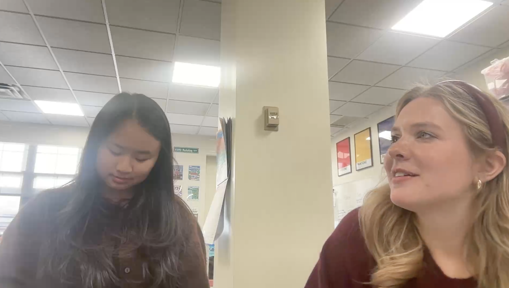
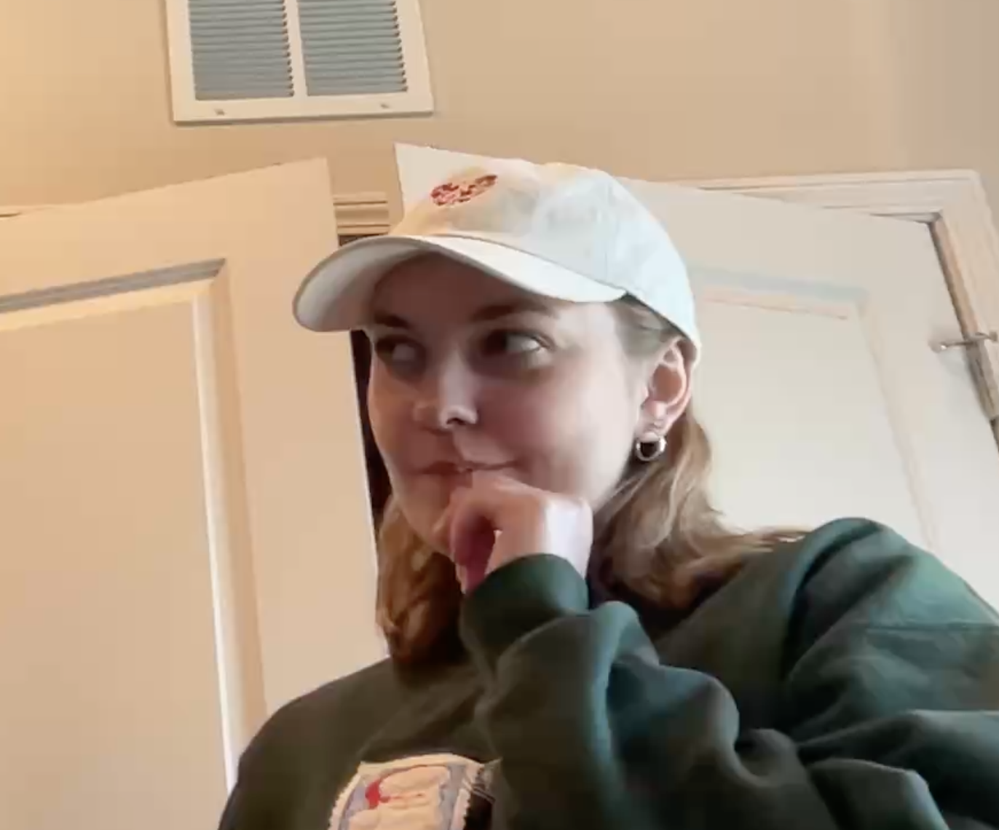
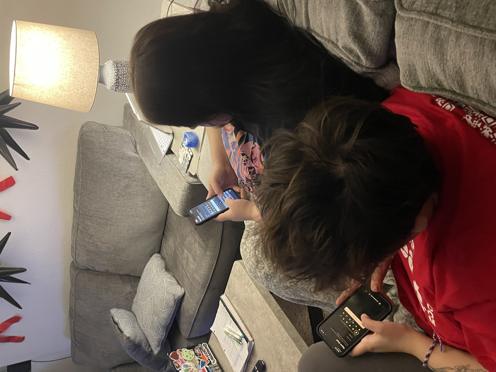

# User testing: OpenSeat

## Testing sessions

### Friday, November 13

### Sunday, November 15

## What worked

- Testers liked writing things like "by the windows, green backpack" or "I'm wearing a red sweater" so the group can spot each other.
- **Picking a topic for study groups** made the study option feel useful.
- **Being anonymous makes it stand out.** One tester said it feels different from just texting with strangers.
- One tester suggested a Snap Map-style view of people heading to the meeting spot.

## Would they use it?

- **Mixed Reviews.** One tester said no: they'd rather eat alone, or just walk up to someone, than meet strangers through an app.
- **Another would only use it if their friends did,** but said they'd try it out of curiosity as a freshman.
- **A third said they'd be more likely to use it** if they could choose to meet only other girls their age.

## What they asked for

- **Let people choose** between staying anonymous and showing a profile or preferences.
- **Filters** for gender and class year (for example, only meeting other freshmen or seniors).
- **Off-campus plans and errands,** like grocery runs. This would help students who don't have a car.
- **Fix the location lists.** Libraries appeared under the lunch tab and specific dining spot names like the Underground were missing.
- **Smaller groups.** Meeting five new people felt like a lot.
- **Less waiting.** Two minutes felt long. Let the group start as soon as three people are in. Maybe we need to add some sort of large timer to coundown?

## Safety

- **Meet only in public, approved spaces.** No dorm rooms but still open to going off campus to go grocery shopping or a coffee shop to study.
- **Verify identity:** log in with a student email or ID and lock the account to one phone, or scan an ID and your face the way dating apps do.
- **Require at least three people per group,** so it can't be used as a dating app.
