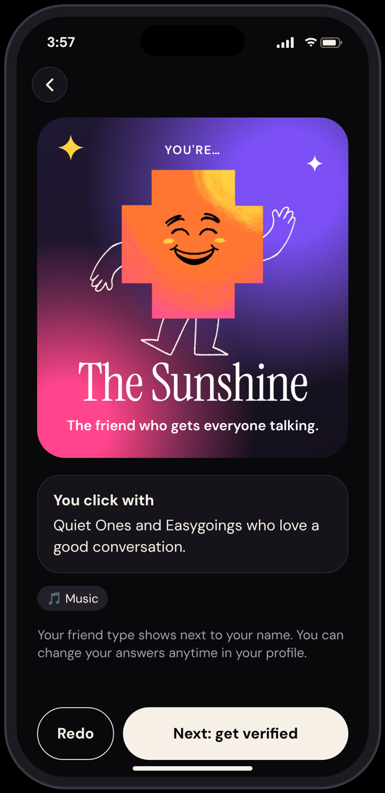
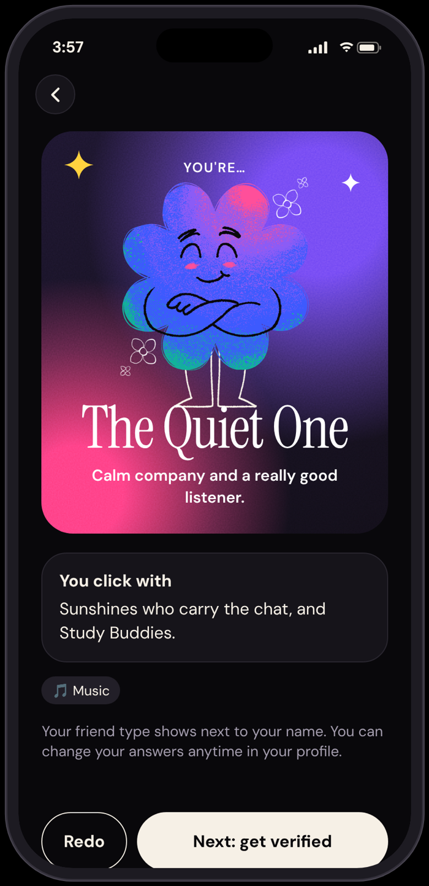
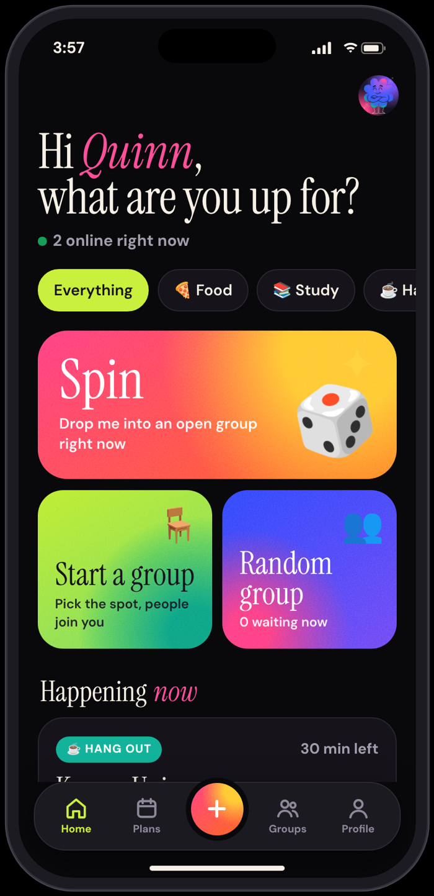
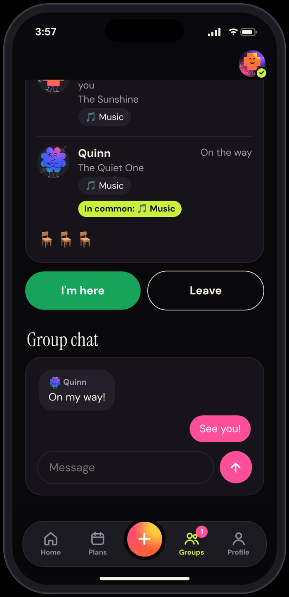

# Open Seat: Madi V4

- **Dates:** Monday, November 16 to Wednesday, November 18
- **Try it:**      https://open-seat-madi-v4.madi-ixd-bpt.workers.dev

## Why

Our groups testing from this past weekend, gave us a long list of fixes. V4 is where I'm working through them, as well as adding in some branding. 

## What I changed, and the feedback behind it

### Safety

- **KU email and student ID verification.** Sign-up asks for an @ku.edu email, and adding a photo of your student ID earns a ✓ Verified badge. It's a prototype, so nothing is really checked. Testers asked for verification with a student email or ID.
- **Only verified public places.** When you start a group or plan an outing, you type the place, a spinner checks it, and only places on the list of public spots are allowed. Dorm rooms, homes and street addresses are turned away. Testers said no dorm rooms.
- **Groups are at least 3 people, up to 5.** People pick the size. Testers said five new people felt like a lot, and a minimum of three keeps it from being used as a dating app.
- **Which floor you're on.** "How to find you" now asks for a floor (or "Outside / out front") along with what to look for.

### Matching and comfort settings

- **Interests in the quiz.** People pick up to 6, groups show what you have in common, and matching favors shared interests.
- **The quiz explains itself.** An intro screen says it's a personality quiz to find out what kind of friend you are and who you click with. Results now include "You click with…"

### More than lunch and study

- **Four activities:** Food, Study, Hang out and Events, each with its own public spots. Testers found libraries listed under lunch.

- **Plan an outing for later.** Post something happening later in the week ("Jazz night at Liberty Hall, Friday 7 PM"), and others tap "I'm in" and get a group chat before it happens. Testers wanted off-campus plans and errands.

### Waiting for a random group

- **A countdown ring** shows the 2 minutes while a group forms, and each person found pops into a seat. Testers said two minutes felt long without a timer.

### Look and feel

- **A new visual style** inspired by poster design: Instrument Serif headlines, grainy gradients and a black background.
- **Mascots.** I drew the first two, for The Sunshine and The Quiet One, using the app's colors. They replace the emojis everywhere.

## Next

- Draw mascots for the other four friend types: Foodie, Study Buddy, Adventurer and Easygoing.
- Test V4 with 5 strangers to represent a real scenario. 
- Add the rest of the safety list: block and report, a check-in after each meetup, and a "met before" tag.