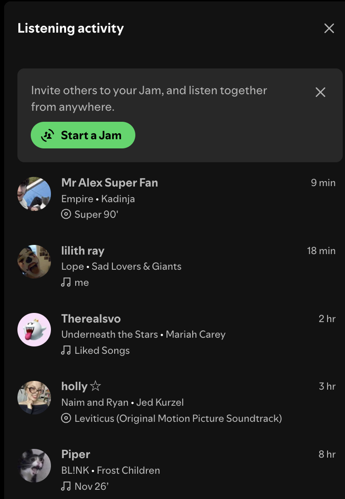
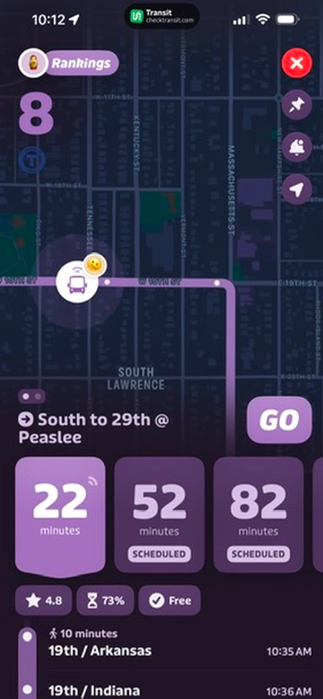
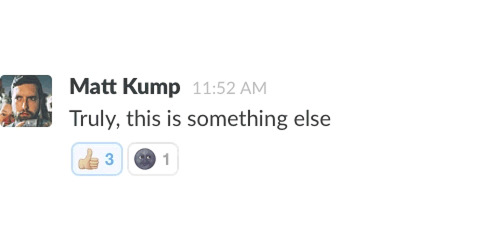

# Multiplayer audit (Week 1, due Wed 11/4)

Each of us uses and documents three different multiplayer things: a game, a shared document, a chat, etc. For each, write down which design choices told you other people were in there with you.

## Cami

### 1. RealTV Fantasy

A fantasy league platform where you make predictions and compete with friends based on what happens on reality TV shows

**Multiplayer design choices:**

- **League members:** seeing other people's names and teams shows you who you're competing against
- **Leaderboard:** Rankings and points lets you compare how well you're doing to other people
- **Player profiles:** every player in your league has a profile and a team name
- **Player count:** the amount of players in your league is displayed on the leaderboard
- **Weekly score updates:** changing in standings after each episode shows players progress
- **Shared deadlines:** everyone has the same deadline to make picks and predictions
- **League chat:** a group conversation giving players a way to react to episodes discuss strategies, and interact directly

### 2. Duolingo

Language learning app that encourages people to stay consistent

**Multiplayer design choices:**

- **Leaderboards:** users are ranked against each other
- **Friend streaks:** friends work together to maintain a shared streak
- **Friend quests:** two friends work together toward a shared goal
- **Pfp and usernames:** every user has a profile and a username
- **Friend Activity:** shows friends accomplishments and allows you to celebrate their progress
- **Reactions:** you can celebrate your friends achievements

### 3. Kahoot

Interactive quiz platform where multiple people play at one time answering questions and earning points

**Multiplayer design choices:**

- **Game pin:** users enter a pin to join the session
- **Player nicknames:** every name appears in the lobby, showing who has joined
- **Player count:** displays how many people are participating
- **Live leaderboard:** shows who is currently at the top after each question
- **Kahoot:** shows how many people selected each answer
- **Countdown timer:** creates shared urgency
- **Podium:** shows top 3 at the end

## Loudon

_Wednesday, 11/4. A cleaned-up version of my rough notes and annotations._

### 1. Spotify (Listening activity and Jam)

Music streaming. The Listening activity panel shows what friends played recently, and Jam lets people listen to one shared queue together.

**Multiplayer design choices:**

- **Profile pictures and display names:** each friend shows up as themselves, with names they chose ("Mr Alex Super Fan," "holly ☆"), so it's partly a performance
- **What they played:** song and artist, plus where it came from, an album (disc icon) or a playlist (note icon)
- **Playlist names:** "me," "Liked Songs," "Nov 26'" give away a little personality people didn't directly choose to share
- **Time stamps:** 9 min, 18 min, 2 hr, newest at the top. Nobody here is listening right now, so it's traces of people, not live presence
- **"Start a Jam" prompt:** "Invite others to your Jam, and listen together from anywhere." Seeing friends' traces is the hook, and the button turns it into something live and together

### 2. Transit (Lawrence bus app)

Live bus tracking for Lawrence Transit. The GO feature lets riders share their trip to improve tracking for everyone.

**Multiplayer design choices:**

- **Emoji rider on the bus:** a small face with signal waves on the moving bus shows someone is riding it right now and sharing their trip. You know someone is there without knowing who
- **Live vs. scheduled:** "22 minutes" is bright with a signal icon because it's live data; "52" and "82" are dimmed and labeled SCHEDULED
- **Rankings:** a leaderboard ("8") for riders who share trips, which rewards helping other riders with a bit of competition
- **Crowd ratings:** ★ 4.8 and ⌛ 73% sum up other riders' experiences as numbers
- **Sharing location as helping:** sharing where you are is presented as useful and a little playful, not creepy

### 3. Slack (Reactions)

Workplace and group chat. Reactions let people respond to a message with an emoji instead of writing a reply.

**Multiplayer design choices:**

- **Reaction counts:** 👍 3 shows at a glance how many people saw the message and agreed
- **Your reaction highlighted:** the blue outline on 👍 means I'm one of the 3, so you know you're counted
- **Different reactions side by side:** 🌚 1 next to 👍 3 shows a mixed response, adding a sly tone the words alone can't
- **Names on hover:** counts show right away, and who reacted shows when you hover
- **One tap to take part:** joining an existing reaction is the lowest-effort way to be part of a conversation

### What they have in common

All three show that other people are there without making you talk to them: a face on a bus, an emoji under a message, a song with a time stamp. Each one also gives a small next step: join the Jam, ride with GO, add a reaction. Interview 1 said people already use emojis to replace tone and body language when texting, and Slack builds that habit into the design. For our project, this is the pattern to borrow: show that people are around, then make the first step a single tap.

## Madi

### 1. Microsoft Teams

Workplace and school chat app with group chats, calls and shared channels

**Multiplayer design choices:**

- **Status indicators:** profile pictures with status dots show who is available
- **Typing indicator:** shows when someone is writing a message
- **Member count:** the group chat tab displays the number of members
- **Group image:** new group chats show a combined profile image made of cropped member photos
- **Messages and reactions:** members can post, respond and give feedback

### 2. Roblox

Online game platform where players join each other's games

**Multiplayer design choices:**

- **Add Friends tab:** makes it easy to connect with other players
- **Avatars:** other players appear as characters within multiplayer games
- **Player list:** pressing Tab in some games displays a list of other players
- **Text and voice chat:** players can communicate during games

### 3. Canva

Design tool where several people can edit the same document or slideshow

**Multiplayer design choices:**

- **Collaborator avatars:** profile pictures at the top of the page show who is collaborating
- **Per-page presence:** in multi-page documents or slideshows, profile pictures show who is working on each page
- **Named cursors:** when editing the same page, names follow each person's cursor
- **Selection outlines:** selected text boxes and graphics are outlined in a colored box to show who is editing them
