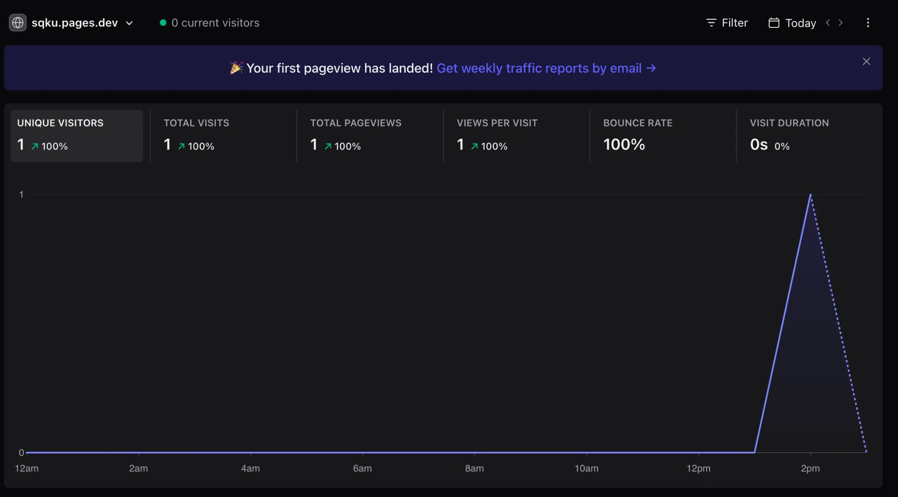

# Log

Updated at least weekly. For each entry: what we tested, with whom, what happened, what surprised us. Newest at the top.

## Week 4

### Loudon: analytics hooked up (Mon 11/23)

- **What:** added [Plausible](https://plausible.io) analytics to Open Seat V3 to count the number of users.
- **Where:** the app now has a short link, https://sqku.pages.dev, and that's the site Plausible tracks. The tracking snippet is in [Loudon/Open_Seat_V3/public/index.html](Loudon/Open_Seat_V3/public/index.html).
- **Proof:** the first pageview landed today. Plausible shows 1 unique visitor (my own test visit).

- **Next:** share sqku.pages.dev with testers so every visit counts toward our numbers.

## Week 3

### Loudon: user testing Open Seat V3

- **What I tested:** [Open Seat V3](Loudon/Open_Seat_V3/), with the new personality quiz and comfort settings (who you're OK sitting with), live at https://open-seat-v3.loudonnokes.workers.dev
- **With whom:** 5 people. Users 1 and 2 were screen recorded: [user 1 on my phone](Loudon/recordings/2026-11-16_user1_phone.mp4), [user 2 on my laptop](Loudon/recordings/2026-11-16_user2_laptop.mov).
- **Biggest thing that came out of this: a bug.** The recording caught a group disappearing. User 2 joined user 1's group and sent "Coming." in the chat, and about 3 seconds later the group was just gone. Nobody left, there were still 44 minutes on the timer, and both people were still online. A real user would think they got kicked out. This has to be fixed before the next test.
- **What each user did:**
  - **User 1:** created her profile and clicked through the quiz, and chose up to 3 men if I remember right. She came out as ☕ The Easygoing (vegetarian, $), started a lunch group at DeBruce ("Braids, blue glasses," topic "Anything!", 45 min, 5 people) and tapped I'm here. It took her about a minute and a half from opening the link to hosting a group.
  - **User 2:** went through the quiz, saw user 1's group on the board, joined it and sent "Coming." in the table chat. That's when the group disappeared (the bug above).
  - **User 3:** went through her account process as normal and was tasked with joining the existing group. However, she clicked "women and nonbinary only" so she couldn't find the group. This exposed one big part of the app and a hurdle to figure out in terms of how to actually get people into specific groups and what groups are visible.
  - **User 4:** was told to try to join a group that had been created. This user was genderfluid and chose the "nonbinary" label. This user WAS actually able to see both the new group and user 1's existing group, and joined user 1's group since it was bigger.
  - **User 5:** a man who was confused about being offered the "up to 3 men" option. This pointed out a problem in the questionnaire that needs to be fixed. This user chose "anyone" and was only able to see and join user 1's group. There were 4 whole members in the group by then, and they were all able to chat and see the chat.
- **What surprised me:**
  - The comfort matching worked exactly how it was built, but it's invisible. User 3 had no idea why the group wasn't there, and user 5 had no idea a second group existed.
  - The quiz asks everyone the same comfort question, even men, so "up to 3 men" didn't make sense to user 5.
  - I didn't realize you can't tell what's being clicked in the recordings, because quiz answers and buttons have no selected state.
- **Next:** fix the disappearing group bug, show people why a group is hidden (or let them see it but not join), change the comfort question based on gender, and add selected states.
- Full write-up: [Loudon/2026-11-16_Open_Seat_V3_Testing.md](Loudon/2026-11-16_Open_Seat_V3_Testing.md)

## Week 2

### Cami: multiplayer proof of concept

- **What I made:** a live shared board where everyone on the link sees each other's cursors and drops stickers together: https://group3-test-room.cami-ixd.workers.dev
- **What happened:** two windows on the live site synced right away. Next is getting 5+ people on it at once.
- Details and code: [Cami/multiplayer-poc](Cami/multiplayer-poc/)

### Madi: multiplayer proof of concept

- **What I made:** Tablemates, a live group lobby built with PartyServer on Cloudflare where people who are open to each other get grouped for lunch or studying: https://tablemates.madi-ixd-bpt.workers.dev
- Full log: [Madi/logs/week-2_due-wednesday-november-11.md](Madi/logs/week-2_due-wednesday-november-11.md)
- Code: [Madi/tablemates](Madi/tablemates/)

### Loudon: user testing Open Seat V1

- **What I tested:** the first working prototype of Open Seat ([Loudon/Open_Seat_V1](Loudon/Open_Seat_V1/)), a live app for finding someone to have lunch or study with on campus. You can open a seat, join a table, Spin into a random table, or get a random group.
- **With whom:** 5 people, one-on-one. Something came up with work, so I could only test with one person at a time.
- **What happened:** two people opened their own seats and filled out the whole form. The other three went into a random group (two of them after Spin found no open seats), which couldn't form with only one person. People found the flow easy and intuitive overall, liked emojis as anonymous profiles, and really liked the table chat and the live lobby view. One tester said it made meeting people into a game of sorts.
- **What surprised me:**
  - A woman tester said she wouldn't feel safe being randomly put in a group of all men. People need a way to choose who they meet, like pronouns/gender.
  - Testers wanted to know how they'd actually find the other person, and suggested maps/navigation and indicators that show a person is there. Right now only the person who opens a table describes themselves, so everyone should get a brief note about who they are/what they look like.
  - One tester asked if group searching would time out. I'm thinking of a 120 sec countdown, like Pokemon Go lobbies.
  - The Lunch/Study switch and the "I'm here" button weren't obvious to everyone.
- **Next:** test with several people at the same time so tables and groups actually fill. Bring these findings to crit, then build V2.
- Full notes: [notes/Loudon_V1_User_Testing_Notes.md](notes/Loudon_V1_User_Testing_Notes.md)

## Week 1: Get out there and talk to people

### Session I: Kickoff

- Got the brief and our group: Cami, Loudon, Madi (Group 3).
- Class tldraw room: how did we know somebody else was there? What happened when two of us grabbed the same thing?
  - _notes TBD_
- How we're splitting the work: _TBD. Also fill in the roles in the README team table._
- Interview plan (who, when, and what we actually want to find out):
  - _TBD_
- Set up this repo. Everyone cloned it and committed before leaving the room.
