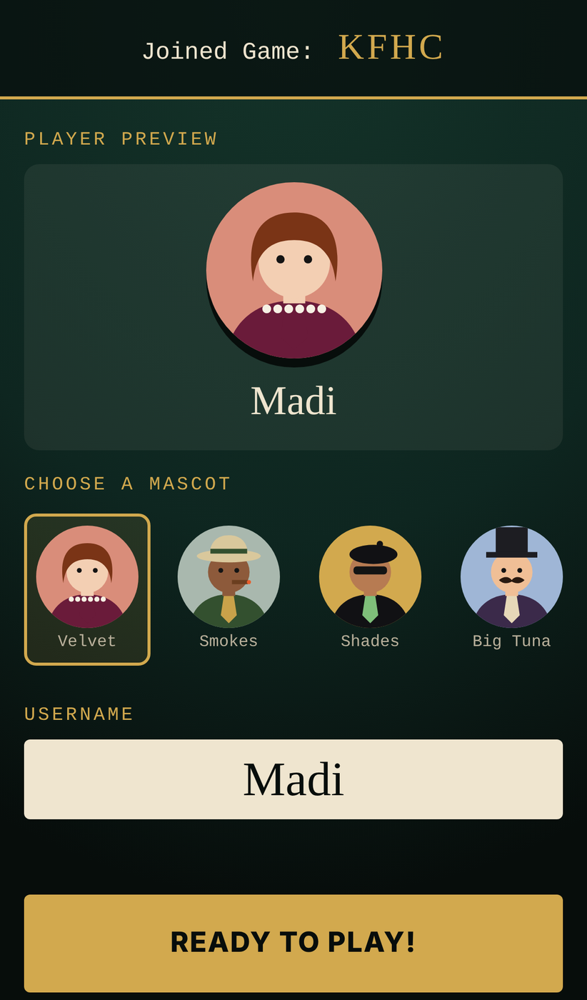
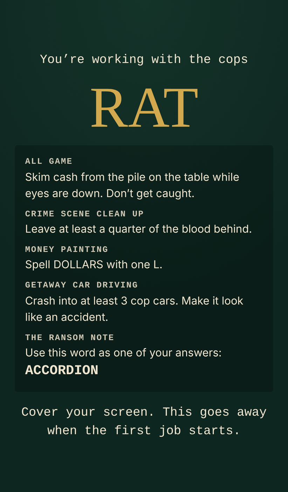
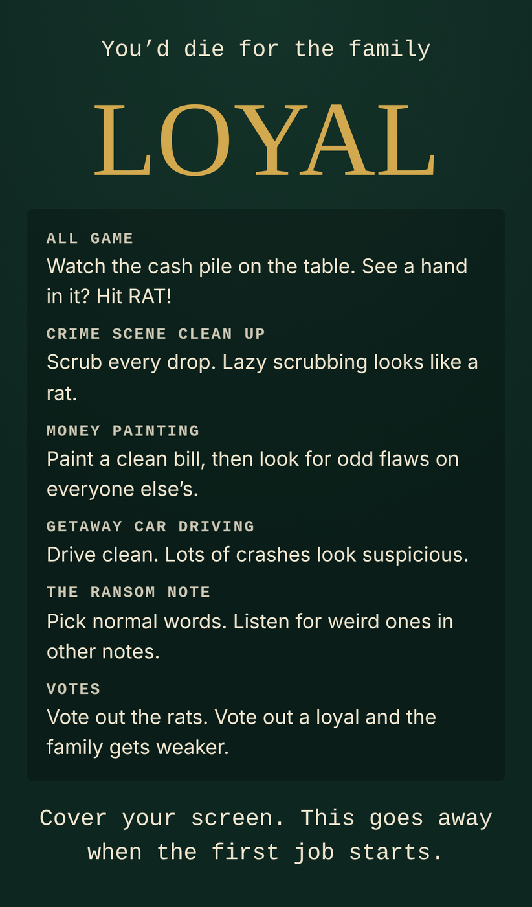
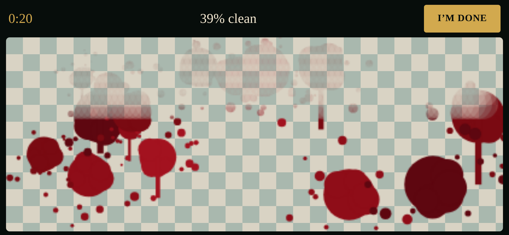
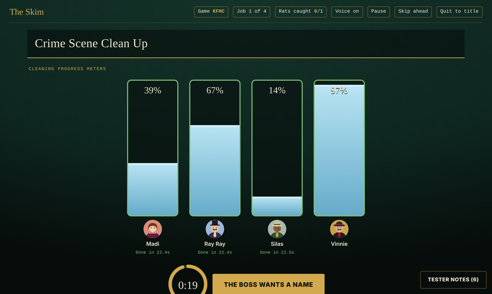
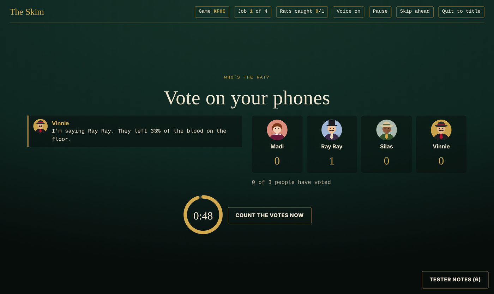
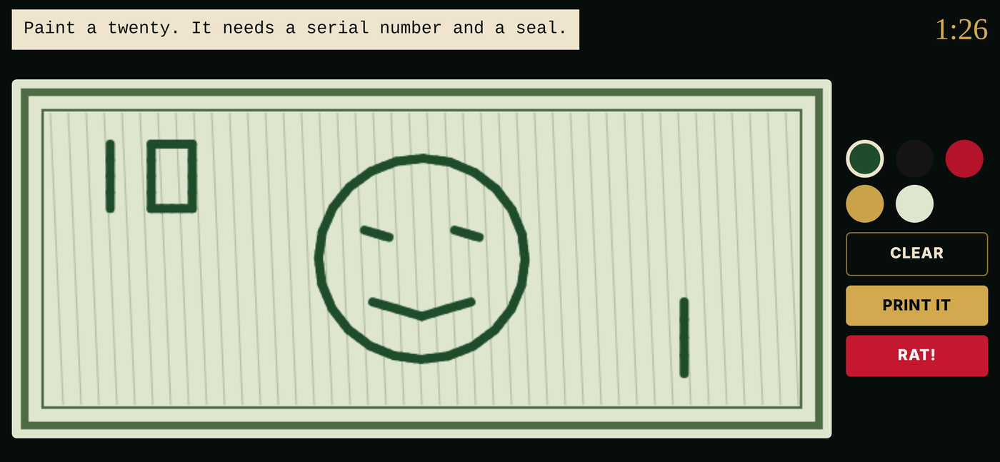
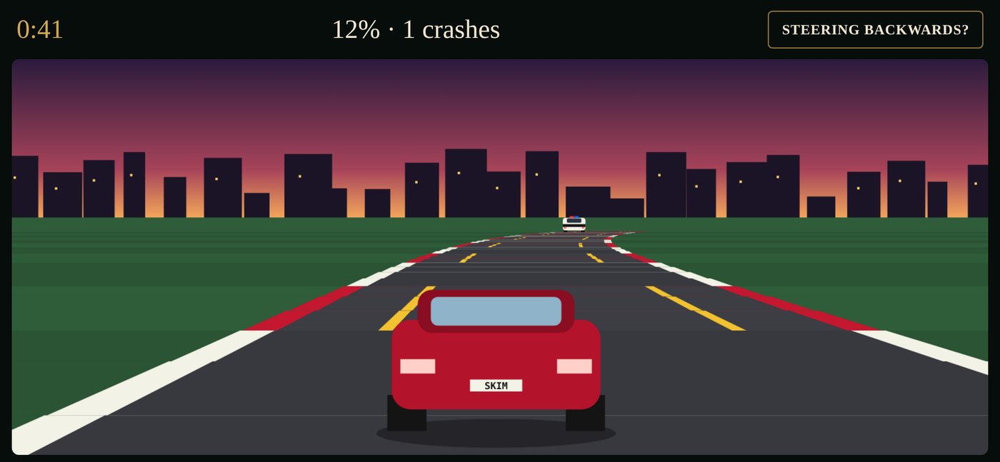
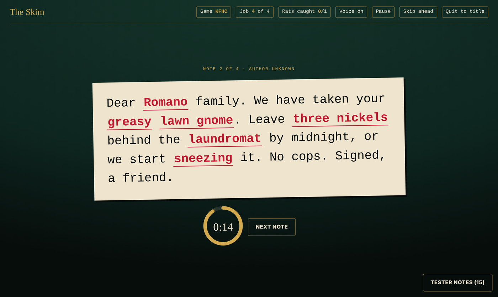
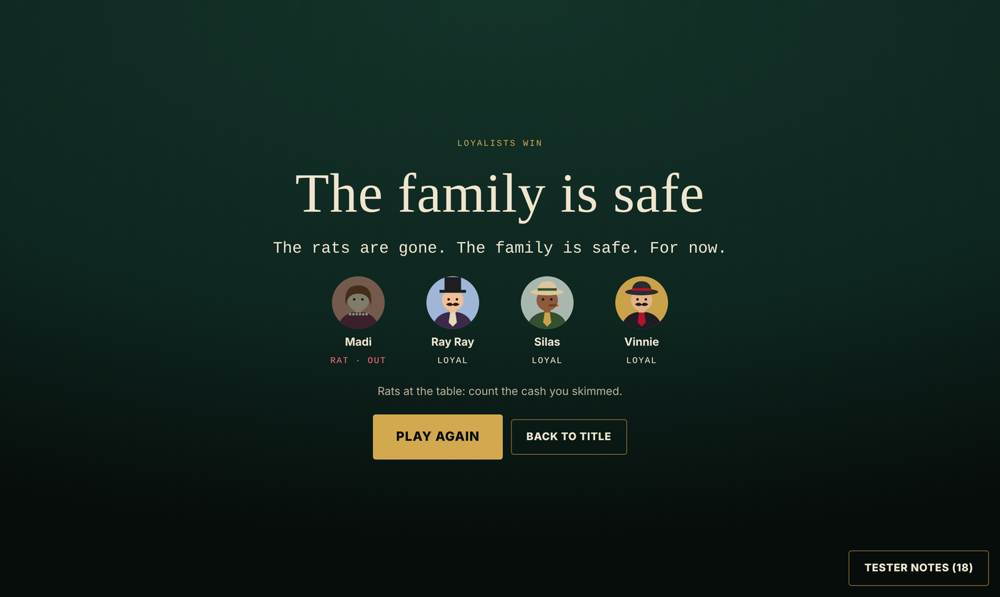

# Interview takeaways

- **Date:** 11/4
- **Interviewer:** Madi
- **Interviews:** 3

---

## Interview 1

### Overall Takeaway

The interviewee doesn't necessarily struggle with having relationships. They struggle more with the effort and initiation required to maintain and expand them. They enjoy spending time with people but don't always initiate contact, sometimes avoid social situations, and can let friendships go quiet even when they still value them.

### How They Connect With Others

- Shared interests, classes, mutual friends, and activities are the primary ways they form friendships.
- Games, baking, movie nights, and shared experiences are some of their favorite ways to spend time with people.
- Use different communication styles depending on the relationship. For example, Snapchat videos with their partner, family group chats with siblings, and phone calls with close family.
- Enjoy multiplayer games and activities that give people a shared goal or something to work toward.

### Challenges / Pain Points

- Struggle with small talk and initiating conversations with new people.
- Sometimes avoid reaching out because they don't want to bother people or assume they're busy.
- Feel guilty about not putting enough effort into maintaining certain friendships.
- Busy schedules, homework, and responsibilities make it difficult to socialize.
- Have trouble getting themselves to attend events, even when interested.
- Group indecision and difficulty making plans can prevent friends from spending time together.
- Don't always want to be on the phone or actively communicate, even with people they care about.

### What They Would Find Helpful

- Reminders or prompts to reach out to friends they haven't talked to in a while.
- Conversation starters to make meeting new people and small talk easier.
- Shared activities, games, or challenges that give friends a reason to interact.
- Easier ways to organize group activities and make decisions.
- Low-pressure ways to meet new people through shared interests.
- Small private communities where friends can share funny posts and interact.

### Potential Design Opportunities

1. **Initiating connection:** Make reaching out to people feel less intimidating through prompts, reminders, or conversation starters.
2. **Shared activities:** Create opportunities for people to connect through games, challenges, and experiences rather than relying entirely on conversation.
3. **Maintaining relationships:** Help people stay connected even when life gets busy or communication styles differ.
4. **Group participation:** Make it easier to organize activities, make plans, and actually follow through on spending time together.

### Biggest Insight

There are different ways to connect with people:

- **Communication:** Texting, calling, sharing videos, and conversation starters.
- **Participation:** Gaming, baking, board games, and shared activities.
- **Consistency:** Reminders, recurring traditions, and making time for relationships.

**Key opportunity:** Explore the intersection of shared activities, low-pressure interaction, and maintaining friendships. Rather than creating another messaging app, consider creating something that gives people a reason to interact in the first place.

---

## Interview 2

### Overall Takeaway

The interviewee is naturally outgoing and enjoys meeting new people, even those who have different interests and perspectives. They believe friendships develop through everyday interactions and being willing to put yourself out there. Unlike someone who relies on shared interests to form friendships, they value differences and see meeting new people as an opportunity to learn. Their biggest emphasis is on in-person interaction, shared experiences, and putting effort into maintaining relationships.

### How They Connect With Others

- Make friends through everyday interactions, proximity, dorms, and simply talking to people around them.
- Don't necessarily seek out people with the same interests. They enjoy meeting people with different perspectives.
- Prefer face-to-face conversations and enjoy phone calls, texting, and FaceTime.
- Like both group and one-on-one interactions, depending on the person and situation.
- Use questions and personal experiences to keep conversations going and make others feel comfortable.
- Enjoy multiplayer games like Fortnite as a way to spend time with friends without needing a lengthy commitment.
- Value casual, everyday hangouts just as much as planned activities.

### Challenges / Pain Points

- Busy schedules and school responsibilities can make it difficult to find time for friends.
- Have difficulty maintaining friendships with people who require planned activities to hang out.
- Have gradually lost touch with most friends from their hometown.
- Find it frustrating when friends are flaky, cancel plans, or avoid communicating about problems.
- Dislike when people talk about someone instead of addressing issues directly.
- Think people are becoming too dependent on digital communication and less comfortable with face-to-face interaction.
- Feel that some social apps can be misused or become uncomfortable when they connect strangers without enough safeguards.

### What They Would Find Helpful / Interesting

- Opportunities to meet people nearby based on location or shared interests.
- A centralized place to discover local events, activities, concerts, and community happenings.
- A weekly event feed that makes it easy to see what's happening without being overwhelmed by a full calendar.
- Games or small interactive activities connected to local events, potentially offering discounts or incentives.
- Ways to meet people through casual, low-pressure activities rather than traditional friend-matching apps.
- Opportunities to connect with people who have different interests and perspectives.
- A way to find someone to accompany them to an activity when they don't have anyone available.

### Potential Design Opportunities

1. **Encouraging in-person interaction:** Create opportunities that get people away from screens and into real-world experiences.
2. **Connecting through proximity:** Help people discover others and activities happening around them, particularly within their college or local community.
3. **Making plans easier:** Help people find someone to join them for everyday activities, events, concerts, errands, or studying.
4. **Discovering local experiences:** Create a centralized weekly feed of nearby events, activities, and opportunities to participate.
5. **Building connections through differences:** Encourage people to meet outside their existing social circles and interact with people who have different perspectives.

### Interesting Ideas Discussed

- **Weekly local activity feed:** A weekly overview of events, farmers markets, concerts, student activities, restaurant promotions, and other things happening nearby.
- **Games tied to local events:** Small games or challenges connected to events that could encourage participation or offer discounts.
- **Proximity-based social platform:** Something that helps people discover what's happening around them and connect with others nearby.
- **Rent-a-friend concept:** A platform where someone can find a person to accompany them to an activity when friends aren't available. Examples included going to concerts, shopping, studying, or trying on dresses. Users could set preferences, screen potential companions, and choose whether to accept requests.
- **Activity-based friend finding:** Rather than matching people based on personality or interests alone, connect them through something they actually want to do.

### Biggest Insight

The interviewee sees connection as something that happens when people are willing to put themselves out there. They don't believe friendships necessarily need to start with shared interests or that every interaction needs to be meaningful or intentional. Sometimes simply being around people and starting a conversation is enough.

They also place a lot of value on in-person experiences. While digital platforms can help people discover one another, they believe the actual interaction should happen in real life.

**Key opportunity:** Explore how to turn everyday activities and local experiences into opportunities for meeting people. Instead of another social media or friend-matching app, consider a platform that helps people find something to do and someone to do it with.

### Research Note

This interview offers a different perspective from the first. While the first interviewee emphasized the difficulty of initiating and maintaining connections, this interviewee is naturally outgoing and believes people need to be more willing to interact face-to-face. Both interviews highlight the importance of shared activities, but they approach the process of making connections very differently.

---

## Interview 3

### Overall Takeaway

The interviewee values friendships that are comfortable, low-maintenance, and don't require constant communication or attention. They have difficulty initiating conversations and making time for social activities because of their busy schedule. Most of their friendships developed through proximity, existing friends, or shared experiences rather than intentionally seeking out new people. Their biggest challenge isn't necessarily finding people they get along with, but having enough time to enjoy those relationships outside of school and work.

### How They Connect With Others

- Make friends through roommates, mutual friends, classes, and shared projects.
- Find it easier to meet people in a group when at least one familiar person is present.
- Struggle to start conversations with people they don't know.
- Use texting, Instagram reels, and occasional voice memos to stay connected with friends from home.
- Value friendships where people can go weeks or months without talking and pick up right where they left off.
- Enjoy playing cooperative or casual games with friends, including Jackbox, Stardew Valley, and It Takes Two.
- Enjoy spending time together while doing separate things, such as watching TV, reading, or working on homework.
- Connect with family through check-in texts, phone calls, and simply being in the same space.

### Challenges / Pain Points

- Busy schedules and schoolwork make it difficult to spend time with friends outside of class or homework.
- Have limited time to participate in clubs and campus events, even when interested.
- Find it difficult to initiate conversations with unfamiliar people.
- Have trouble maintaining friendships when everyone has different schedules.
- Don't always have time for hobbies or activities outside of school.
- Group plans can be difficult to coordinate around everyone's availability and workload.
- Don't want friendships to feel like another responsibility or require constant reassurance.
- Roommate coordination can feel awkward when communicating about shared spaces, chores, and schedules.

### What They Would Find Helpful / Interesting

- A shared friend-group calendar that shows when everyone is free.
- Notifications when multiple friends have an open evening or weekend.
- Calendar integration that helps suggest times to hang out.
- Ability to share upcoming assignments, projects, and workload so friends understand when someone is busy or stressed.
- A way to find someone who wants to attend the same event, see a movie, or try an activity.
- Matching people based on specific activities they both want to do rather than general interests.
- A platform that helps people coordinate everyday tasks, such as grocery shopping, homework, dinner, or laundry.
- Shared roommate schedules for coordinating chores, meals, and use of common spaces.
- A way to plan financially for group activities, trips, or events by sharing price ranges and upcoming costs.

### Potential Design Opportunities

1. **Friend-group scheduling:** Make it easier to find overlapping free time without everyone having to coordinate manually.
2. **Low-pressure connection:** Support friendships that don't require constant communication or elaborate plans.
3. **Activity-based connections:** Help people find others who want to attend the same event or do the same activity.
4. **Workload awareness:** Let friends share busy periods, assignment deadlines, or general availability to make planning easier.
5. **Everyday companionship:** Help people find someone to do routine tasks with, turning ordinary responsibilities into opportunities to spend time together.
6. **Shared living coordination:** Make it easier for roommates to communicate about schedules, chores, and shared spaces.

### Interesting Ideas Discussed

- **Shared friend-group calendar:** A calendar that identifies when everyone is free and suggests opportunities to hang out.
- **Project period tracker:** A way to share upcoming deadlines and workload so friends know when someone might be overwhelmed.
- **Activity-based friend matching:** Connect people who both want to see a movie, attend an event, go shopping, or try something new.
- **Calendar-integrated activity suggestions:** Suggest plans based on free time and events already on someone's calendar.
- **Everyday task companionship:** Find someone to do homework, grocery shopping, laundry, or dinner with.
- **Roommate coordination tool:** Coordinate chores, meals, laundry, and use of shared spaces without awkward conversations.
- **Group savings planner:** Help friends plan ahead financially for trips, events, or more expensive activities.

### Biggest Insight

The interviewee doesn't necessarily need more ways to communicate with their friends. They need more opportunities to actually spend time with them. Their friendships are comfortable enough that they don't require constant check-ins, but busy schedules make it difficult to find time for meaningful experiences outside of schoolwork.

One particularly interesting idea is making ordinary, everyday activities into opportunities for connection. Spending time together doesn't always have to mean planning a big outing. Sometimes it's doing laundry, grocery shopping, homework, or watching a show in the same room.

**Key opportunity:** Help people find time and opportunities to be together, rather than simply giving them another way to message each other.

### Research Note

The third interview adds another perspective to the first two:

- **Interview 1:** Struggles with initiating and maintaining friendships, even when they want to connect.
- **Interview 2:** Is naturally outgoing and believes connection comes from putting yourself out there and participating in experiences.
- **Interview 3:** Values low-maintenance friendships but struggles to make time for them because of school, work, and competing schedules.

All three mention shared activities as an important part of friendship, but the third introduces a stronger focus on scheduling, workload, and the everyday logistics that get in the way of spending time together.

---

## 3 Multiplayer Things

### Microsoft Teams

**Affordances**

- Profile pictures with status indicators show who is available.
- Typing indicator shows when someone is writing a message.
- Group chat tab displays the number of members.
- New group chats show a combined profile image made up of cropped member photos.
- Members can post messages, respond, and give feedback.

### Roblox

**Affordances**

- Add Friends tab makes it easy to connect with other players.
- Other players appear as characters within multiplayer games.
- Pressing Tab in some games displays a list of other players.
- Text chat and voice chat allow players to communicate during games.

### Canva

**Affordances**

- Profile pictures at the top of the page show who is collaborating.
- In multi-page documents or slideshows, profile pictures indicate who is working on each page.
- When editing the same page, names follow each person's cursor.
- Selected text boxes and graphics are outlined in a colored box to show who is editing them.

---

# First concept and user testing: The Skim

- **Date:** 11/7
- **Round:** 1

The direction I chose is a Jackbox-style party game about the mob. Everyone at the table is part of the family, but a few players are secretly rats working with the cops. The laptop is the Boss: it talks, runs the game and shows everyone's progress. Each player joins on their own phone by scanning a QR code, so there's nothing to download.

The game is four short minigames (jobs) in a row. Loyal players try to do each job well. Rats get secret tasks that quietly mess things up. After each job, the table talks it out and votes on who they think the rat is.

I had Claude build a working prototype so I could test it with real people on their own phones.

> These screenshots are recreated from the exact version my testers played in round 1, using made-up players. They weren't captured during the actual test.

## Joining and roles

  
  
  

Players pick a username and a mascot, then hit Ready to play. When the game starts, each phone flashes the player's role. Rats get a secret task for every job (for example, "Spell DOLLARS with one L" on the money). Loyal players get tips on what to look out for.

## Job 1: Crime Scene Clean Up

Players turn their phones sideways and scrub the blood off the floor as fast as they can. Rats are supposed to leave at least a quarter of it behind.

The Boss screen shows everyone's progress as meters filling up, so the table can see who's slacking.

## Voting

After each job, everyone votes on their phone for who they think the rat is. Computer players can fill empty seats, and they chime in with their own accusations based on how people did.

## Job 2: Money Painting

Players paint a bill by hand from a prompt. Rats have to sneak a flaw onto theirs. Then every bill is shown side by side on the big screen.

## Job 3: Getaway Car Driving

Players tilt their phone to steer and race to the hideout while dodging cop cars. Rats are supposed to crash into at least three of them and make it look like an accident.

## Job 4: The Ransom Note

Players fill in Mad Libs-style blanks on their phones. The Boss reads every note out loud, and everyone votes for the best one. Rats have to slip a secret word into theirs.

At the end, the Boss reveals who was loyal and who was the rat.

## User feedback

### What worked

- People had fun from the start. Picking names and mascots got a lot of laughs and joking around.
- The Getaway Car was the favorite. "This is really fun." The tilt steering worked well.
- The Ransom Note got the biggest reactions. Hearing the Boss read the notes out loud, then voting for the best one, was a highlight.
- Players liked that "each bill is different" in Money Painting.
- People liked the look and the fonts.
- The deduction worked at least once: a player caught a rat because she spelled DOLLARS with one L on her bill.

### Pacing and clarity

- **Everything was too fast.** There wasn't enough time to read the role card, so players started the game not knowing what they were supposed to do. One loyal player said they didn't know what was going on the whole time.
- **Rat tasks only showed at the beginning.** Players forgot them, and one rat missed their secret word on the ransom note. They need a reminder before each job.
- **The RAT! button confused people.** One player pressed it just because it was there. "Watch the cash pile" didn't make sense because there was no physical money pile at the table.
- **Rats didn't feel powerful.** Their tasks only hurt their own score, not anyone else's game.
- **The rat card gave the same tasks every time.** Two rats got the same money flaw, which made them easy to spot.
- **Mad Libs needed help.** People asked "What's an adjective again?" They wanted a description for each blank, a dice button for a random word, and more time to write.
- **Waiting was slow.** When everyone finishes early, the game should jump ahead instead of running out the clock.
- **The Boss's voice** could be better, and it needs captions.

### Minigames

- **Turning the phone sideways didn't work well.** Rotating broke things, and the Safari bar at the top got in the way. Most games should stay upright.
- **Crime Scene Clean Up froze** around 96 to 98 percent. Players couldn't reach the corners, and the I'm Done button didn't work.
- **Money Painting:** the "put a famous building on it" prompt was confusing, and there was no vote for the best bill.
- **Getaway Car:** you could drive in the grass the whole way with no penalty.

### Technical issues

- We had to stop in the middle of the game and restart or reconnect.
- Rescanning the QR code led to a blank page.
- Players kept duplicating after reloading their phones ("two Tunas, three Allys"), and there was no way to remove them.
- Voting timed out.
- The game crashed on an older iPad.
- In full screen on a TV, the bottom of the page was cut off.

## Changes for round 2

- The role screen stays up until each player taps Got it, and a reminder of their task shows before every job.
- Each rat gets a different flaw and a different secret word.
- The RAT! button is gone. Rats now sabotage other players during a job (they can't hit the same person twice), and the victim's phone flashes. Everyone gets a Watch button with tips on what to look for.
- Phones stay upright for every game except the Getaway Car.
- Crime Scene Clean Up is rebuilt: lifting your finger no longer stops you, the edges are easier to reach, and the job finishes at 95 percent.
- The Ransom Note has a hint for every blank, a dice button for a random word, and more time.
- Players vote for the best bill and the best ransom note. The winner gets the Boss's protection from the next vote.
- Driving in the grass slows the car down.
- Players can rejoin with the same name, the host can remove extra players, and the game pauses if a player who still owes work drops out.
- The game moves on as soon as everyone is done, and the Boss's voice has captions.
